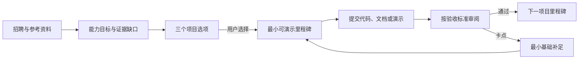

# 参考驱动的个性化项目计划 v0.2

## 目标

用户不从一长串课程开始，而是先选择一个能在一周内交付、能支撑目标岗位证据的项目。Agent 用招聘要求和可信参考资料定义“项目应证明什么”；项目推进中出现真实阻塞时，才安排最小必要的基础补足。

这适合当前用户：AI 产品为首选方向、Agent 应用开发为备选；数学硕士，有基础 Python，尚无可展示项目；每天两小时用于项目开发。

## 参考证据层

每条参考必须有 URL 或用户提供的原文、发布时间、采集日期、原始引用、用途和状态。Agent 不把链接标题或帖子摘要当作事实本身。

| 资料类别 | 建议来源 | 能用于什么 | 不能用于什么 |
| --- | --- | --- | --- |
| 岗位事实 | 公司官网招聘页、官方招聘公告、用户提交的完整 JD | 提取职责、硬条件、加分项、招聘样本覆盖范围 | 直接判定个人是否会被录用 |
| 技术事实 | 官方 API/框架文档、官方工程公告 | 决定接口、限制、实现步骤 | 推导该技术为所有岗位必需 |
| 实践经验 | 小红书、Reddit、YouTube、天涯或其他论坛公开帖子 | 发现面试形式、常见项目形态、用户痛点、检索词 | 单独成为岗位硬要求或能力结论 |
| 用户证据 | 代码、运行记录、演示、文档、面试反馈 | 判断项目完成度与能力证据 | 代替外部市场信号 |

小红书、Reddit、YouTube 和天涯的内容应保留平台、作者/频道、发布时间、URL、原文摘录和“仅经验信号”标签。天涯等历史社区的内容还要标注时间较早、可访问性或上下文不完整。抓取只使用公开可访问页面和允许的接口；页面需要登录、反爬或内容删除时，记录失败并允许用户粘贴内容，不绕过限制。

### 发布时间与浏览量

发布时间决定**时效度**：近期资料优先用于正在招聘的岗位、不断变化的工具和面试流程；较早资料保留为背景案例，并明确标注历史性。

浏览量决定**阅读优先级**：在同一平台、同类内容内，优先看更高浏览或互动分位的帖子。原始浏览量不能跨平台直接比较，因此参考记录使用平台内百分位；没有可比较的分位时标为“不可用”，不猜测其热度。

它们不能单独决定**可信度**。一条十万浏览的小红书经验帖仍然只能支持“可能的项目或面试模式”；一条较早但仍有效的官方技术公告仍能约束实现。可否进入计划由来源类型、连续原文引用和审阅状态共同决定。

### 资料进入计划的规则

1. 计划中的“岗位必须项”只来自 JD 或官方招聘资料。
2. 官方技术资料可决定实现约束，例如某 API 的结构化输出格式。
3. 经验帖只形成“待验证的建议”，至少需要两个独立帖子或用户自己的验证，才可提高优先级。
4. 每项项目任务至少链接一条岗位证据或一条被验证的项目目标；没有依据的任务不排进本周。
5. Agent 展示参考摘要时，注明资料类型、日期与局限，不把经验帖伪装成市场统计。

## 项目选择器

先生成最多三个可行项目，每个项目都显示对应岗位能力、可见成果、技术范围、基础前置和一周风险。用户选择一个；Agent 不因“看起来更高级”自动替用户选择。

| 项目 | 主要岗位证据 | 一周可见成果 | 本周不做 |
| --- | --- | --- | --- |
| A. 证据型求职准备 Agent | AI 产品中的用户洞察、快速原型、验证；Agent 应用中的结构化提取与工作流 | 聊天输入 JD、原文可追溯的差距报告、两小时任务、成果反馈与计划版本 | 自动投递、完整招聘爬虫、多 Agent |
| B. 企业知识管理 RAG 助手 | 企业协作、知识管理、RAG/智能流程编排 | 小型资料集、检索结果引用、未命中提示、五条评测记录 | 大规模知识库、泛化企业部署 |
| C. AI 产品需求研究助手 | AI 产品中的用户洞察、技术转业务、项目验证 | 访谈/帖子洞察卡、问题聚类、功能假设、验证脚本与复盘 | 伪造用户访谈、自动声称市场结论 |

对当前项目，A 是默认推荐：已有代码、测试和五份 JD 样本，能在有限时间内形成从需求到验证的完整叙事。B 和 C 是可选替代，不与 A 同时开工。

## 从单岗位到岗位类别

用户的目标可以是“AI 产品”或“Agent 应用开发”这类岗位类别，并且可以在聊天里逐条填写自己正在投递、收藏或关注的招聘简介。每条简介保存为 `user_provided` 来源，带用户的优先级、原文和聊天消息关联；它不要求有公开链接。

Agent 对每条简介做独立提取和引用校验，再在审阅后附上统一的 `capability_key`。例如“分析用户反馈”和“用户洞察”可能映射为同一个能力，但不能仅靠关键词自动合并。随后生成类别能力地图：

- **core**：至少两条招聘简介都明确列为必需。
- **targeted**：只在一条高优先级简介中出现的必需能力。
- **watch**：低优先级或暂时只出现一次的必需能力。
- **optional**：加分项，保持为加分项。

项目计划优先补 `core`，再补一个和选定项目匹配的 `targeted` 能力；不试图用一个一周项目覆盖类别内全部岗位。用户之后填入新简介时，能力地图和后续计划可以重新计算，旧计划保留版本记录。

## 快速有效的推进循环

每次只安排一个可验证里程碑，默认 90 分钟实现 + 30 分钟运行、记录和复盘。没有当前卡点时，不安排脱离项目的通用课程。

## 基础补足规则

| 观察到的卡点 | 最小补足任务 | 回到项目的验证 |
| --- | --- | --- |
| 无法读写或理解 JSON 数据 | 20 分钟读取一份 JD 并打印两个字段 | 将这份数据接回提取或报告流程 |
| 无法解释模型输出如何进入系统 | 20 分钟画“输入→结构化输出→引用校验→报告”图 | 对一条新 JD 指出每一步产物 |
| 不能判断输出是否可信 | 30 分钟补一条失败测试，如“优先”误判为必需 | 测试失败后修复并保留前后记录 |
| RAG 检索结果没有来源 | 30 分钟为每段结果保留文档片段和位置 | 演示回答能够打开来源；无来源时明确说不知道 |
| 前端或服务化阻塞演示 | 30 分钟做单一输入和结果页面/命令入口 | 新输入可完成一次端到端演示 |

“不会”只能依据失败证据或用户明确说明；单次卡点也可能是环境、说明或实现问题。补课结束后必须回到同一个项目里程碑，不无限扩展学习清单。

## 用户看到的计划卡

每张计划卡包含：本步项目目标、时间预算、交付物、验收方法、依据引用、依赖的基础知识、失败时的缩减方案。用户可接受、调整预算或选择另一项目；Agent 保留版本历史。

## 下一轮实现

1. 建立 `references.json`，将资料按来源类别与用途保存。
2. 建立 `project_catalog.json`，让项目选项与岗位证据、里程碑和基础补足映射数据化。
3. 接入公开资料时先做来源采集和审阅，再让它影响计划；不让未经审阅的帖子自动改变岗位结论。
4. 在成果审阅后根据“通过 / 需要证据 / 需要修改 / 阻塞类型”选择下一步或基础补足任务。
